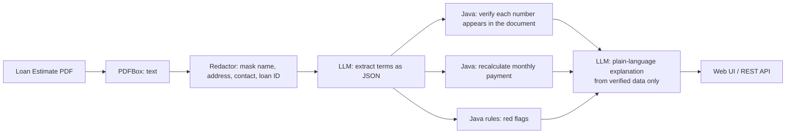

# LoanLens

**Explains a mortgage Loan Estimate in plain language and double-checks the numbers.** Upload a Loan Estimate PDF and LoanLens reads it with an LLM, verifies every extracted figure against the document, recalculates the monthly payment, raises red flags as plain-language questions to ask the lender, explains the loan in English, Spanish, Hindi or Telugu, and compares two offers side by side.

Built in **Java 21 + Spring Boot 3 + Spring AI**, with **Apache PDFBox** for PDF text, a **local LLM via Ollama** (no document leaves the machine), and an **evaluation harness** that scores field-level extraction accuracy and red-flag precision/recall.

> All sample documents are **synthetic** (fictional lenders, people and numbers), with a layout loosely modeled on the CFPB Loan Estimate. Educational tool, not financial or legal advice.

---

## Why this exists

A Loan Estimate is one of the most important documents a home buyer receives, and one of the hardest to read: dozens of fees, two different rates (interest rate and APR), and terms like *points*, *rate lock* and *prepayment penalty*. Many borrowers sign without understanding what they are comparing. LoanLens turns the document into a short explanation plus a checklist of questions for the lender.

## How it works



The design rule is **the LLM reads and writes words; Java does the math and the judging.**

| Step | Who does it | Why |
|---|---|---|
| Read the PDF | PDFBox | Deterministic, no AI needed |
| Mask personal data | `Redactor` (regex on the form's own labels) | The model never sees the borrower's name, address, phone, email or loan ID |
| Extract ~15 fields | LLM, JSON mode, temperature 0 | Handles layout variations a regex can't |
| Verify the numbers | `GroundingChecker` | Every extracted figure must literally appear in the document, which catches hallucinated values |
| Recalculate the payment | `PaymentCalculator` (amortization formula) | Catches extraction errors *and* errors in the document itself |
| Red flags | `RedFlagRules` | Same loan, same flags, every time; each rule is unit-tested |
| Explain | LLM | Sees only verified terms and rule-based flags, so it can't invent new figures |

### Red flags (questions to ask your lender)

| Code | Raised when |
|---|---|
| `PREPAYMENT_PENALTY` | The loan charges a fee for paying off early |
| `BALLOON_PAYMENT` | A lump sum is due at a set date |
| `RATE_NOT_LOCKED` | The rate and points can still change |
| `ADJUSTABLE_RATE` | The rate can rise after the fixed period |
| `HIGH_ORIGINATION` | Origination charges exceed 1% of the loan amount |
| `POINTS_PAID` | 1 or more discount points |
| `APR_GAP` | APR is more than 0.5 points above the interest rate (fees built in) |
| `PAYMENT_MISMATCH` | The printed monthly payment differs from the recalculated one by more than $1 |

## Run it

### Mac (Apple Silicon)

Install **Docker Desktop** and the **Ollama** app (ollama.com) and open both. Then in Terminal:

```bash
git clone https://github.com/Mahipvk/loan-lens && cd loan-lens
docker compose -f docker-compose.mac.yml up --build
```

Open **http://localhost:8081** when the log says `Started LoanLensApplication`. (Port 8081, so it can run next to IncidentPilot on 8080.)

### Windows (PowerShell)

```powershell
git clone https://github.com/Mahipvk/loan-lens; cd loan-lens
docker compose up --build
```

## Use it

- **Explain:** pick a sample (or upload your own Loan Estimate PDF), choose a language, click *Explain this loan*.
- **Compare:** pick two offers and see rate, APR, recalculated payment, closing costs, approximate 5-year cost and flags side by side.
- **Evals:** *Run evals* checks 10 fields per document and the red flags against known answers.

## The test documents

| Sample | Designed to test |
|---|---|
| `sunrise-bank` | A clean 30-year fixed loan, so no flags should fire |
| `harbor-lending` | Prepayment penalty, unlocked rate, 1.5 points, high lender fees |
| `quickfund-arm` | Adjustable rate, high fees, large APR gap |
| `maple-cu` | A 15-year loan whose **printed monthly payment is deliberately wrong by $40**; the recalculation must catch it |

Ground truth for each is in `src/main/resources/samples/*.json`; the PDFs are generated by `tools/make_samples.py`.

## Evaluation results

Run on a MacBook Air M4 (16 GB), model `qwen2.5:7b` via Ollama, 4 synthetic documents:

| Field accuracy (10 fields x 4 documents) | Red-flag precision | Red-flag recall | Avg time / document (extraction + checks) |
|---|---|---|---|
| **40/40 (100%)** | **8/8 (100%)** | **8/8 (100%)** | 16.6 s |

The deliberately wrong payment in `maple-cu` was caught by the recalculation in every run.

**Caveats, stated plainly:** four documents that share one layout, generated by the same author who wrote the rules, is an easy test. Real Loan Estimates vary in layout, are sometimes scanned, and would be harder. Each figure is a single run of a non-deterministic model.

## Known limitation: the explanation can still speculate

The plain-language explanation only receives verified numbers, but in testing the model still **invented a reason** for the `maple-cu` payment mismatch ("the extra $40 likely covers additional fees"; P&I never includes fees). Adding an explicit "never guess the reason for a flagged problem" instruction reduced this but did not eliminate it ("could be due to additional fees or adjustments"), and the model once stated "no origination fees" while also listing $750 of them.

Lesson: **a prompt instruction lowers the rate of a failure; it does not guarantee its absence.** The planned fix is a deterministic output check: Java writes the sentence about any flagged mismatch itself, and the generated explanation is scanned for speculation phrases and for dollar figures that aren't in the verified data, and regenerated or trimmed if it fails.

## What I learned building it

1. **Let the LLM read; let code do the math.** Extraction by the model was 100% accurate here, but every number is still verified against the document and the payment is recalculated. That is how the wrong printed payment was caught.
2. **Mask personal data using the form's own labels.** Names can't be found reliably with a regex, but "APPLICANTS", "PROPERTY" and "LOAN ID #" can.
3. **Explanation is the hardest part to make trustworthy**, harder than extraction (see the known limitation above).

## Roadmap

- [ ] Output guardrail on the explanation: deterministic mismatch sentence, speculation and unsupported-number checks
- [ ] Closing Disclosure support, plus a check that it matches the earlier Loan Estimate
- [ ] Scanned PDFs via OCR or a vision model
- [ ] More test documents, including real public sample forms
- [ ] Compare a local model against a cloud model on the same evals
